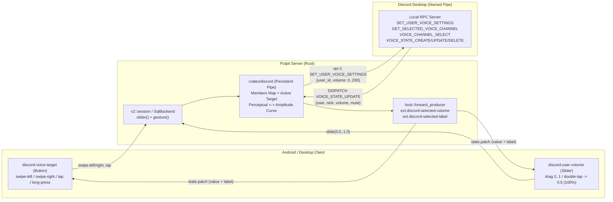

# Discord Voice Member Volume — Local RPC Research & Pulpit Integration Guide

## 1. Executive Summary

**Yes — per-user local receive volume is officially reachable over Pulpit's existing Discord local IPC pipe.**

Discord's local RPC server (`\\?\pipe\discord-ipc-0..9`) exposes the documented **`SET_USER_VOICE_SETTINGS`** command (`rpc.voice.write` scope), alongside **`GET_SELECTED_VOICE_CHANNEL`** (`rpc.voice.read`) and channel-scoped **`VOICE_STATE_CREATE` / `VOICE_STATE_UPDATE` / `VOICE_STATE_DELETE`** events (`rpc.voice.read`) for enumerating voice-channel members, reading their `user.bot` flags, and tracking live per-user volume/mute changes made inside the Discord desktop UI. This is the exact mechanism used by Elgato Stream Deck's official Discord plugin ("User Volume Control").

### Why Pulpit Already Satisfies the OAuth2 Requirement
Although Discord restricts `rpc`, `rpc.voice.read`, and `rpc.voice.write` for publicly distributed third-party OAuth2 apps, Discord's local RPC server permits an unapproved application's **Application Owner** (and up to 50 invited **App Testers** in the Discord Developer Portal) to authorize those scopes against their own desktop client. Because Pulpit uses a bring-your-own Discord application (`discordClientId` + `discordClientSecret` in `~/pulpitApp/settings.json`) and `crates/discord/src/lib.rs` (`SCOPES`, lines 58–65) **already requests** `["identify", "rpc", "rpc.notifications.read", "rpc.voice.read", "rpc.voice.write", "rpc.activities.write"]`, existing authenticated Pulpit users already hold the required scopes—no re-authorization or client modding is needed.

### Three Critical Engineering Constraints
1. **Perceptual vs. Amplitude Volume Curve (`@discordapp/perceptual`)**: Discord's UI right-click slider displays *perceptual* loudness (`0%–200%`), whereas `SET_USER_VOICE_SETTINGS` (`args.volume`) and `VOICE_STATE_*` (`data.volume`) exchange **linear amplitude multipliers** (`0–200`, spanning a `50 dB` exponential curve below `100%` and a `+6 dB` boost curve from `100%` to `200%`). Sending raw `volume: 50` sets the Discord UI slider to **`~88%`**, not `50%` (perceptual `50%` corresponds to amplitude `5.62` $\to$ integer `6`). Pulpit must convert between normalized slider position (`0.0..=1.0`), perceptual percentage (`0..=200%`), and RPC amplitude (`0..=200`).
2. **Single-Modifier RPC Lock & Reset-on-Disconnect**: Discord's local RPC server allows only **one** connected RPC app at a time to mutate voice settings (`SET_VOICE_SETTINGS` / `SET_USER_VOICE_SETTINGS`). Calling either acquires a session lock (blocking other RPC voice controllers such as Elgato Stream Deck while Pulpit is connected) and **reverts RPC-modified user volumes when the pipe disconnects**, re-applying them if the app reconnects. Because Pulpit's `DiscordClient` maintains a single long-lived pipe connection for the lifetime of the server process, overrides stay active throughout the Pulpit session.
3. **Slider Gesture & Dynamic Label Constraints in Pulpit**:
   - Protocol v2 (`docs/protocol-v2.md` §6, `crates/v2/src/boards.rs:301–354`) and both clients (`TileCell.vue`, `Tile.kt`) forbid custom gestures (`swipe-left`, `swipe-right`) on `slider`/`knob` tiles because any drag on a slider surface immediately updates its value (`startSlider` / `detectDragGestures.onDragStart` jumps to `1 - y/height` on pointer-down). Bot/member switching via `swipe-left`/`swipe-right` must therefore live on a **paired selector button tile** (or be avoided via **pinned per-bot slider tiles**).
   - Android's `SliderTile` (`apps/mobile/.../ui/Tile.kt:489–592`) currently renders **only** the vertical bar and centered icon (ignoring `title` and `liveText`), and Desktop's `TileCell.vue` (`lines 513, 780–805`) renders only static `tile.title` with hardcoded `sliderValue()` branches. Showing live `<member name> + <volume %>` on a slider requires coordinated updates across `crates/v2` + `crates/legacy`, `TileCell.vue`, and `Tile.kt` (`AGENTS.md` 3-surface rule), plus adding `exec_discord` dispatch to `SqlBackend::slider` (`crates/backend/src/lib.rs:509–528`).

---

## 2. Discord Local RPC Reference for Voice & Member Enumeration

### 2.1 Transport, Framing & Handshake

Pulpit's `crates/discord/src/lib.rs` already implements the binary framing over `\\?\pipe\discord-ipc-0` .. `discord-ipc-9` (Windows) / `$XDG_RUNTIME_DIR/discord-ipc-0..9` (Unix):

| Offset | Type | Description |
| :--- | :--- | :--- |
| `0..4` | `i32` LE | Opcode: `0` = `HANDSHAKE`, `1` = `FRAME`, `2` = `CLOSE`, `3` = `PING`, `4` = `PONG` |
| `4..8` | `i32` LE | Payload byte length |
| `8..8+len` | UTF-8 JSON | Command, response, or `DISPATCH` event object |

**Session sequence** (`crates/discord/src/lib.rs:480–569`):
1. Send `op = 0`: `{"v": 1, "client_id": "<app_id>"}` $\to$ receive `op = 1`, `{"cmd": "DISPATCH", "evt": "READY", "data": {"v": 1, "config": {...}, "user": {...}}}`.
2. Send `op = 1`: `{"cmd": "AUTHENTICATE", "args": {"access_token": "<bearer>"}, "nonce": "..."}` (if cached token invalid/missing, run `AUTHORIZE` $\to$ exchange code at `https://discord.com/api/v10/oauth2/token` $\to$ `AUTHENTICATE`).

> **64-bit Snowflake Warning**: Every Discord `user_id`, `channel_id`, and `guild_id` is an unsigned 64-bit integer serialized as a **JSON string** (e.g., `"411916947773587456"`). Never coerce Snowflakes to JavaScript `Number` in `apps/desktop` (`Number.MAX_SAFE_INTEGER` is $2^{53}-1 = 9007199254740991$, which silently truncates modern Discord IDs and causes RPC `4000 Invalid Payload` / unknown user errors). Always keep IDs as `String` across Rust, JSON, Vue, and Kotlin.

---

### 2.2 Voice Commands (`op = 1`)

All commands use `{"cmd": "<COMMAND>", "args": { ... }, "nonce": "<unique-string>"}`. Subscriptions add a **top-level `"evt"` field** alongside `"cmd"` and `"args"`. Error responses return `"evt": "ERROR"` with `"data": {"code": <int>, "message": "<string>"}`.

| Command | Required Scope | Purpose | Notes |
| :--- | :--- | :--- | :--- |
| `GET_VOICE_SETTINGS` | `rpc.voice.read` | Read local user's input/output devices, self-mute/deaf, PTT/VAD | Already implemented in `crates/discord`. |
| `SET_VOICE_SETTINGS` | `rpc.voice.write` | Mutate local user's own voice settings (`mute`, `deaf`, output `volume`, etc.) | Already implemented in `crates/discord`. Acquires single-modifier voice lock. |
| `SET_VOICE_SETTINGS_2` | `rpc.local` *(undocumented)* | GameSDK/Social SDK self-mute/deaf/input-mode setter | Returns `data: null`. Not needed when `rpc.voice.write` is available. |
| `SET_USER_VOICE_SETTINGS` | `rpc.voice.write` | **Set local per-user `volume` (`0..=200`), `pan`, and local `mute` for a remote user** | **Primary command for this feature.** Documented in official RPC docs. |
| `SET_USER_VOICE_SETTINGS_2` | `rpc.local` *(undocumented)* | GameSDK variant (`user_id`, `volume`, `mute`; no `pan`) | Returns `data: null`. Undocumented internal twin. |
| `SELECT_VOICE_CHANNEL` | `rpc.voice.write` | Join (`channel_id: "<id>"`) or leave (`channel_id: null`) a voice channel | Already implemented in `crates/discord` (`force: true` avoids error `5003` when switching channels). |
| `GET_SELECTED_VOICE_CHANNEL` | `rpc.voice.read` | **Fetch the voice channel the local user is currently connected to, including full `voice_states` array** | Returns `null` in `data` if not currently in voice. **Primary initial-state query.** |
| `GET_CHANNEL` | `rpc` | Fetch any channel by `channel_id` (includes `voice_states` for voice channels) | Useful only if inspecting a channel the user hasn't joined; returns error `4005` on invalid ID. |
| `GET_CHANNELS` | `rpc` | List guild channels (`args: {"guild_id": "<id>"}`) | Returns partial `{id, name, type}` objects **without** `voice_states`. |
| `SUBSCRIBE` / `UNSUBSCRIBE` | Event-dependent | Register/unregister `DISPATCH` event delivery | Requires top-level `"evt": "<EVENT_NAME>"` in the request frame. |

*(Note: There is **no** `GET_SELECTED_VOICES` or `GET_USER_VOICE_SETTINGS` command in Discord's RPC server. Per-user `volume`, `mute`, and `pan` for every member in the channel are returned inline inside each `RPCVoiceState` entry of `GET_SELECTED_VOICE_CHANNEL` and `VOICE_STATE_*`.)*

#### Exact Command Schemas

##### `GET_VOICE_SETTINGS` & `SET_VOICE_SETTINGS`
- **`GET_VOICE_SETTINGS` `args`**: `{}`
- **`SET_VOICE_SETTINGS` `args`**: Partial object of the response shape below (all fields optional).
- **Response `data`** (also payload of `VOICE_SETTINGS_UPDATE`):
```json
{
  "input": {
    "device_id": "default",
    "volume": 100.0,
    "available_devices": [{ "id": "default", "name": "Default" }]
  },
  "output": {
    "device_id": "default",
    "volume": 100.0,
    "available_devices": [{ "id": "default", "name": "Default" }]
  },
  "mode": {
    "type": "VOICE_ACTIVITY",
    "auto_threshold": true,
    "threshold": -60.0,
    "shortcut": [{ "type": 0, "code": 42, "name": "left shift" }],
    "delay": 100.0
  },
  "automatic_gain_control": true,
  "echo_cancellation": true,
  "noise_suppression": true,
  "qos": false,
  "silence_warning": true,
  "deaf": false,
  "mute": false
}
```

##### `SET_USER_VOICE_SETTINGS` (Official Documented Per-User Volume Command)
- **`args`**:
  - `user_id` (`string`, **required**): Target remote member's Discord Snowflake ID.
  - `pan` (`object`, optional): `{"left": <f64 0.0..=1.0>, "right": <f64 0.0..=1.0>}`.
  - `volume` (`integer`, optional): Linear amplitude multiplier `0..=200` (`100` = unity `0 dB` = `100%` perceptual; `200` = `+6 dB` = `200%` perceptual). Schema-validated as an integer in RPC command input.
  - `mute` (`boolean`, optional): Local client-side mute override for this user.
- **Response `data`**:
```json
{
  "user_id": "411916947773587456",
  "pan": { "left": 1.0, "right": 1.0 },
  "volume": 100,
  "mute": false
}
```

##### `GET_SELECTED_VOICE_CHANNEL`
- **`args`**: `{}`
- **Response `data`**: `null` when disconnected from voice, or a `Get Channel` object (`type`: `2` = `GUILD_VOICE`, `13` = `GUILD_STAGE_VOICE`, `1` = `DM`, `3` = `GROUP_DM`):
```json
{
  "id": "832012345678901234",
  "guild_id": "197038439483310086",
  "name": "Music Lounge",
  "type": 2,
  "topic": "",
  "bitrate": 64000,
  "user_limit": 0,
  "position": 3,
  "voice_states": [
    {
      "nick": "Jockie Music (1)",
      "mute": false,
      "volume": 5.623413251903491,
      "pan": { "left": 1.0, "right": 1.0 },
      "voice_state": {
        "mute": false,
        "deaf": false,
        "self_mute": false,
        "self_deaf": true,
        "suppress": false
      },
      "user": {
        "id": "411916947773587456",
        "username": "Jockie Music",
        "discriminator": "8148",
        "global_name": null,
        "avatar": "8a9d2f...",
        "bot": true
      }
    }
  ],
  "messages": []
}
```
*(Note: For DM/Group DM calls, `guild_id` may be omitted/`null`.)*

##### `SELECT_VOICE_CHANNEL`
- **`args`**: `{"channel_id": "<snowflake>" | null, "timeout"?: <int seconds>, "force"?: <bool>, "navigate"?: <bool>}`
- **Response `data`**: Same `Get Channel` object as `GET_SELECTED_VOICE_CHANNEL` (or `null` when leaving). Without `"force": true`, attempting to switch while already in a voice channel returns RPC error `5003` (`SELECT_VOICE_FORCE_REQUIRED`).

---

### 2.3 Voice Subscriptions & `DISPATCH` Event Payloads

> **Implementation catch in `crates/discord/src/lib.rs`**: `Conn::request_until` (`line 581`) currently serializes `{"cmd": cmd, "args": args, "nonce": nonce}` with no `"evt"` field. Discord's `SUBSCRIBE` and `UNSUBSCRIBE` commands require `"evt"` at the **top level** of the frame:
> ```json
> {
>   "cmd": "SUBSCRIBE",
>   "evt": "VOICE_STATE_UPDATE",
>   "args": { "channel_id": "832012345678901234" },
>   "nonce": "pulpit-sub-1"
> }
> ```

| Event (`evt`) | Scope | `SUBSCRIBE` `args` | When It Fires |
| :--- | :--- | :--- | :--- |
| `VOICE_CHANNEL_SELECT` | `rpc.voice.read` | `{}` | Local user joins, switches, or disconnects (`channel_id: null`) from a voice channel. |
| `VOICE_STATE_CREATE` | `rpc.voice.read` | `{"channel_id": "<id>"}` | Another user (or bot) joins `channel_id`. |
| `VOICE_STATE_UPDATE` | `rpc.voice.read` | `{"channel_id": "<id>"}` | A member in `channel_id` changes mute/deaf/nick, **or local user changes that member's local `volume`/`mute`/`pan` in Discord UI or via RPC**. |
| `VOICE_STATE_DELETE` | `rpc.voice.read` | `{"channel_id": "<id>"}` | A member leaves or is disconnected from `channel_id`. |
| `SPEAKING_START` | `rpc.voice.read` | `{"channel_id": "<id>"}` | Member starts transmitting RTP audio packets (useful to auto-detect which music bot is actively playing). |
| `SPEAKING_STOP` | `rpc.voice.read` | `{"channel_id": "<id>"}` | Member stops transmitting audio packets. |
| `VOICE_SETTINGS_UPDATE` | `rpc.voice.read` | `{}` | Local user's own mute/deaf/device settings change. *(Note: `crates/discord/src/lib.rs:351` already parses inbound `VOICE_SETTINGS_UPDATE`, but never sends `SUBSCRIBE` for it!)* |
| `VOICE_CONNECTION_STATUS` | `rpc.voice.read` | `{}` | RTC state transitions (`VOICE_CONNECTED`, `DISCONNECTED`, ping stats). |

#### Exact Event `data` Shapes

##### `VOICE_CHANNEL_SELECT`
```json
{
  "cmd": "DISPATCH",
  "evt": "VOICE_CHANNEL_SELECT",
  "data": {
    "channel_id": "832012345678901234",
    "guild_id": "197038439483310086"
  }
}
```
When the local user leaves voice, `"data"` is `{"channel_id": null}` (`guild_id` is omitted or `null`).

##### `VOICE_STATE_CREATE` / `VOICE_STATE_UPDATE` / `VOICE_STATE_DELETE` (`RPCVoiceState`)
```json
{
  "cmd": "DISPATCH",
  "evt": "VOICE_STATE_UPDATE",
  "data": {
    "nick": "Jockie Music (1)",
    "mute": false,
    "volume": 100.0,
    "pan": { "left": 1.0, "right": 1.0 },
    "voice_state": {
      "mute": false,
      "deaf": false,
      "self_mute": false,
      "self_deaf": true,
      "suppress": false
    },
    "user": {
      "id": "411916947773587456",
      "username": "Jockie Music",
      "discriminator": "8148",
      "global_name": null,
      "avatar": "8a9d2f...",
      "bot": true
    }
  }
}
```

**Field-by-field semantics in `RPCVoiceState`**:
- `user.id` (`string`): Member Snowflake ID (compare against `READY.data.user.id` to exclude the local user from remote-member targets!).
- `user.bot` (`bool`, default `false` if omitted): **`true` for all Discord bot accounts** (music bots, moderation bots). Allows Pulpit to filter or prioritize bots automatically.
- **Display name resolution order**: non-empty `nick` (server nickname) $\to$ non-empty `user.global_name` (display name) $\to$ `user.username`.
- Top-level `volume` (`f64`): Local client's amplitude override (`0.0..=200.0`). Can be fractional when adjusted via Discord's UI slider, so deserialize as `f64`, **not** `u32`!
- Top-level `mute` (`bool`): Local client's "Mute User" checkbox for this remote member.
- `voice_state.{mute, deaf, self_mute, self_deaf, suppress}` (`bool`): Server/remote flags (note: music bots routinely set `self_deaf: true` to save bandwidth while transmitting audio).
- Unlike Gateway `VOICE_STATE_UPDATE`, RPC `RPCVoiceState` **does not contain `channel_id` or `guild_id`** inside `data`.

##### `SPEAKING_START` / `SPEAKING_STOP`
```json
{
  "cmd": "DISPATCH",
  "evt": "SPEAKING_START",
  "data": {
    "channel_id": "832012345678901234",
    "user_id": "411916947773587456"
  }
}
```

---

### 2.4 How to Enumerate & Track Voice Channel Members Reliably

Because `VOICE_STATE_CREATE/UPDATE/DELETE` require a specific `channel_id` in `SUBSCRIBE` `args` (there is no wildcard subscription across all channels), member tracking follows a deterministic 4-step state machine:

1. **On RPC `AUTHENTICATE` success**:
   - Record `self_user_id = READY.data.user.id` (or `AUTHENTICATE.data.user.id`).
   - `SUBSCRIBE` to `VOICE_CHANNEL_SELECT` (`args: {}`) and `VOICE_SETTINGS_UPDATE` (`args: {}`).
   - Call `GET_SELECTED_VOICE_CHANNEL` (`args: {}`).
   - If `data` is non-null, enter `attach_channel(data.id, data.voice_states)`.
2. **`attach_channel(new_channel_id, initial_voice_states)`**:
   - Seed an ordered map `members: BTreeMap<String, MemberVoice>` from `initial_voice_states`, skipping `entry.user.id == self_user_id`.
   - `SUBSCRIBE` with `args: {"channel_id": new_channel_id}` to:
     - `VOICE_STATE_CREATE`
     - `VOICE_STATE_UPDATE`
     - `VOICE_STATE_DELETE`
     - `SPEAKING_START` / `SPEAKING_STOP` *(optional, low-frequency for bots, enables speaking indicator & auto-selecting the playing music bot)*
3. **On `VOICE_CHANNEL_SELECT` dispatch (`data.channel_id`)**:
   - If `prev_channel_id == data.channel_id`, no-op.
   - If `prev_channel_id` was `Some(old_id)`, `UNSUBSCRIBE` the channel-scoped events for `old_id` and clear `members`.
   - If `data.channel_id` is `Some(new_id)`, call `GET_SELECTED_VOICE_CHANNEL` to fetch the full snapshot of existing `voice_states`, then run `attach_channel(new_id, voice_states)`. *(Note: subscribe before or immediately alongside `GET_SELECTED_VOICE_CHANNEL` and idempotently upsert by `user.id` so no join/leave race is missed.)*
4. **On `VOICE_STATE_*` dispatches**:
   - `VOICE_STATE_CREATE` / `VOICE_STATE_UPDATE`: if `user.id != self_user_id`, upsert `members[user.id]`.
   - `VOICE_STATE_DELETE`: remove `members[user.id]`. If the deleted user was the active slider target, advance selection to the next available bot/member (or clear target if empty).

*(Edge case — large Stage channels: standard guild voice channels cap at 99 users; `GET_SELECTED_VOICE_CHANNEL` returns all connected `voice_states` in a single local IPC frame without pagination.)*

---

## 3. Per-User Volume: Documented vs. Undocumented Options

### 3.1 Option A (Recommended): Official `SET_USER_VOICE_SETTINGS` over Local RPC

#### Perceptual Loudness vs. RPC Amplitude Math (`@discordapp/perceptual`)

Discord's desktop client converts between UI slider percentage $P \in [0, 200]$ and native media-engine/RPC amplitude $A \in [0, 200]$ using its open-source `@discordapp/perceptual` curve (`RANGE = 50 dB` for $0..100\%$, `+6 dB` boost for $100..200\%$):

| UI Slider % ($P$) | Pulpit Slider `0..1` ($v = P / 200$) | Gain (dB) | Exact Amplitude ($A$) | RPC `SET_USER_VOICE_SETTINGS` `volume` (`round(A)`) |
| :---: | :---: | :---: | :---: | :---: |
| `0%` | `0.00` | $-\infty\text{ dB}$ | `0.00` | `0` |
| `25%` | `0.125` | $-37.5\text{ dB}$ | `1.33` | `1` |
| `50%` | `0.25` | $-25.0\text{ dB}$ | `5.62` | `6` |
| `75%` | `0.375` | $-12.5\text{ dB}$ | `23.71` | `24` |
| `88%` | `0.44` | $-6.0\text{ dB}$ | `50.12` | `50` |
| `100%` (default) | `0.50` | `0.0 dB` | `100.00` | `100` |
| `150%` | `0.75` | `+3.0 dB` | `141.25` | `141` |
| `200%` (max) | `1.00` | `+6.0 dB` | `199.53` | `200` |

**Exact Rust conversion helpers** (drop-in for `crates/discord`):
```rust
/// Convert normalized Pulpit slider value (0.0..=1.0, where 0.5 == 100% UI)
/// into Discord RPC integer amplitude (0..=200) for SET_USER_VOICE_SETTINGS.
pub fn slider_to_rpc_amplitude(v: f64) -> u8 {
    let perceptual = (v.clamp(0.0, 1.0) * 200.0).clamp(0.0, 200.0);
    if perceptual <= 0.0 {
        return 0;
    }
    let amp = if perceptual > 100.0 {
        let db = ((perceptual - 100.0) / 100.0) * 6.0;
        100.0 * 10.0_f64.powf(db / 20.0)
    } else {
        let db = (perceptual / 100.0 - 1.0) * 50.0;
        100.0 * 10.0_f64.powf(db / 20.0)
    };
    amp.round().clamp(0.0, 200.0) as u8
}

/// Convert Discord RPC amplitude (0.0..=200.0 from VOICE_STATE_UPDATE / GET_SELECTED_VOICE_CHANNEL)
/// back into normalized Pulpit slider value (0.0..=1.0) and UI percentage (0..=200).
pub fn rpc_amplitude_to_slider(amplitude: f64) -> (f64, u16) {
    if amplitude <= 0.0 {
        return (0.0, 0);
    }
    let db = 20.0 * (amplitude / 100.0).log10();
    let perceptual = if db > 0.0 {
        (100.0 * (1.0 + db / 6.0)).clamp(0.0, 200.0)
    } else {
        (100.0 * (1.0 + db / 50.0)).clamp(0.0, 200.0)
    };
    (perceptual / 200.0, perceptual.round() as u16)
}
```
> **Low-end quantization note**: Because `SET_USER_VOICE_SETTINGS` validates `volume` as an integer (`0..=200`) rather than a float, perceptual values between `~1%` and `~22%` ($A \in [0.32, 1.49]$) all quantize to integer amplitude `1` (`-40 dB`, displayed as `20%` in Discord UI), and `< ~10%` ($A < 0.5$) rounds to `0` (`0%`). Clamping non-zero perceptual inputs `(0.0, 20.0)` to at least `1` prevents accidental mute until the user drags all the way to `0%`.

#### Concrete Wire Frame Examples (Opcode `1` JSON Payloads)

**1. Query current voice channel + member volumes on connect**:
```json
{
  "cmd": "GET_SELECTED_VOICE_CHANNEL",
  "args": {},
  "nonce": "pulpit-7"
}
```

**2. Subscribe to channel member updates**:
```json
{
  "cmd": "SUBSCRIBE",
  "evt": "VOICE_STATE_UPDATE",
  "args": {
    "channel_id": "832012345678901234"
  },
  "nonce": "pulpit-8"
}
```

**3. Set music bot volume to perceptual `50%` (`v = 0.25` $\to$ RPC amplitude `6`)**:
```json
{
  "cmd": "SET_USER_VOICE_SETTINGS",
  "args": {
    "user_id": "411916947773587456",
    "volume": 6
  },
  "nonce": "pulpit-9"
}
```
Response frame (`op = 1`):
```json
{
  "cmd": "SET_USER_VOICE_SETTINGS",
  "data": {
    "user_id": "411916947773587456",
    "pan": { "left": 1.0, "right": 1.0 },
    "volume": 6,
    "mute": false
  },
  "evt": null,
  "nonce": "pulpit-9"
}
```
*(Followed immediately by a `DISPATCH` `VOICE_STATE_UPDATE` frame if subscribed to the active `channel_id`.)*

**4. Toggle local mute on the target music bot**:
```json
{
  "cmd": "SET_USER_VOICE_SETTINGS",
  "args": {
    "user_id": "411916947773587456",
    "mute": true
  },
  "nonce": "pulpit-10"
}
```

#### Single-Modifier Lock & Disconnect Reset Semantics
Per Discord's official RPC documentation:
- **Exclusive Voice Lock**: Only one RPC app can hold voice-settings write control simultaneously. If Elgato Stream Deck's Discord plugin is already running and has mutated voice settings, Pulpit's `SET_USER_VOICE_SETTINGS` (or existing `SET_VOICE_SETTINGS` mute/deaf!) will fail with an RPC error until the other app disconnects—and vice versa.
- **Session Ephemerality**: Discord snapshots original user voice settings before an RPC session mutates them and restores the pre-RPC values when the IPC socket closes (re-applying the RPC app's overrides when the same `client_id` reconnects). Because Pulpit's `DiscordClient` keeps its IPC connection open across commands, volumes stay set while Pulpit runs.
- **Drag Rate Limiting**: Dragging a slider on Android/Desktop emits continuous updates (throttled client-side to ~25–40 Hz). In `crates/discord`, slider writes should **coalesce** (latest-wins per `user_id`, e.g. at most 15–20 RPC calls/sec or wait for prior in-flight `SET_USER_VOICE_SETTINGS` ACK before sending the newest pending value) so rapid drags never queue up stale IPC frames.

---

### 3.2 Undocumented & Client-Mod Internals (How Discord & Vencord/BetterDiscord Do It)

For completeness (Question 2), reverse-engineering and client mods (`Vencord` `VolumeBooster`, `BetterDiscord` `BetterVolume`, `docs.discord.food`) reveal how Discord's desktop client implements per-user volume internally:

1. **Internal Renderer Flux Action (`MediaEngineActions.setLocalVolume`)**:
   - Inside Discord's Electron renderer (Webpack bundle), user volume is controlled by `MediaEngineActions.setLocalVolume(userId: string, volume: number, context: "default" | "stream" = "default")`.
   - This dispatches Flux action:
     ```js
     FluxDispatcher.dispatch({
       type: "AUDIO_SET_LOCAL_VOLUME",
       userId: "411916947773587456",
       volume: 5.623413251903491, // amplitude (0..200 normally; Vencord patches UI max to 400..1000)
       context: "default"         // "default" = voice audio, "stream" = Go Live screen-share audio
     });
     ```
   - `MediaEngineStore` updates `settingsByContext[context].localVolumes[userId]` and invokes the native C++ voice module (`discord_voice.node` $\to$ `DiscordEngine::SetLocalVolume(userId, volume)`), which scales decoded Opus PCM samples locally.
   - Note that `SET_USER_VOICE_SETTINGS` over the IPC pipe calls this exact internal `MediaEngineActions.setLocalVolume(user_id, volume, "default")` handler inside Discord's RPC server module, restricted to `[0, 200]` and `"default"` context (`"stream"` Go Live volume is not exposed on `SET_USER_VOICE_SETTINGS`).
2. **Undocumented RPC Command `SET_USER_VOICE_SETTINGS_2`**:
   - Found in Discord's internal RPC command table (`docs.discord.food/topics/rpc`):
     ```json
     {
       "cmd": "SET_USER_VOICE_SETTINGS_2",
       "args": { "user_id": "411916947773587456", "volume": 100, "mute": false },
       "nonce": "..."
     }
     ```
   - Scoped to `rpc.local` (Discord GameSDK / Social SDK overlay bridge), omits `pan`, and returns `data: null`. Offers **no advantage** over documented `SET_USER_VOICE_SETTINGS` for Pulpit, which already authenticates with `rpc.voice.write`.
3. **Persistence (`LevelDB` + `PreloadedUserSettings` Protobuf)**:
   - `%APPDATA%\discord\settings.json` only stores Electron shell settings (`WINDOW_BOUNDS`, `MINIMIZE_TO_TRAY`, `DANGEROUS_ENABLE_DEVTOOLS_ONLY_ENABLE_IF_YOU_KNOW_WHAT_YOURE_DOING`). **User volumes are NOT in `settings.json`.**
   - `MediaEngineStore` persists `localVolumes` in Chromium's local storage LevelDB (`%APPDATA%\discord\Local Storage\leveldb`) **and** syncs modified user volumes to Discord's backend via `PreloadedUserSettings` protobuf (`AudioContextSettings.user_settings`, wire type `USER_SETTINGS_PROTO_UPDATE`, proto type `1`), where Discord's server clamps `volume` to `[0, 200]`.
4. **StreamKit Client ID Spoofing (`207646673902501888`)**:
   - Some third-party utilities spoof Discord's first-party StreamKit Overlay `client_id` (`207646673902501888`, origin `https://streamkit.discord.com`) to obtain `rpc.voice.*` without creating a Developer Portal app. Pulpit **does not need this** because Pulpit users already configure their own Developer Portal app (`discordClientId` / `discordClientSecret`), where owner authorization of `rpc.voice.read` + `rpc.voice.write` works natively and legitimately.

---

## 4. Conceptual Audio Model, Fallback Paths & Risk Matrix

### 4.1 Conceptual Model Confirmation
Discord voice channels use an SFU (Selective Forwarding Unit) architecture over WebRTC/UDP:
- A music bot encodes **one** Opus RTP stream and sends it to Discord's voice server, which forwards identical Opus packets to every listener in the channel.
- **A bot cannot set per-listener volume.** Any volume change inside the bot alters the PCM gain prior to Opus encoding and therefore changes loudness for **every human in the channel simultaneously**.
- Conversely, per-user volume in Discord (`SET_USER_VOICE_SETTINGS` / right-click slider) is **100% client-side post-decode PCM scaling** inside the listener's own desktop app. Nobody else hears the change, and it works identically on **every** bot and human regardless of bot vendor or premium tier.

### 4.2 Fallback Paths & Tradeoffs

| Path | How It Works | Pros | Cons / Why Inferior to Local RPC |
| :--- | :--- | :--- | :--- |
| **1. Official Local RPC (`SET_USER_VOICE_SETTINGS`)** *(Recommended)* | Opcode-1 RPC frame over `\\?\pipe\discord-ipc-*` using Pulpit's existing OAuth token (`rpc.voice.write`). | Zero ToS risk; works on **all** bots & humans; affects **only** local listener; live two-way sync via `VOICE_STATE_UPDATE`; ~5 ms local latency. | Resets on Pulpit exit; conflicts if Elgato Stream Deck Discord plugin is simultaneously mutating voice settings; requires BYO Discord App owner/tester auth (already required by Pulpit). |
| **2. Public Music-Bot `/volume` Commands** | Changing playback gain inside the bot (e.g., `/volume 50`). | Survives Discord restarts; works on mobile/console listeners too. | **1) Affects everyone in the channel.**<br>**2) Paywalled on most major public bots** because PCM volume scaling breaks zero-copy Opus passthrough and spikes Lavalink CPU: **FredBoat** (Patreon-only), **Pancake** (Patreon-only), **Jockie Music** (Premium-only), **Green-bot** (vote/premium-locked).<br>**3) Cannot be automated cleanly**: Discord bots ignore slash commands/messages sent by webhooks or other bots, and sending `/volume` with a user token (`POST /api/v9/interactions`) is **self-botting (strict ToS ban risk)**. |
| **3. Self-Hosted Bot HTTP / Lavalink REST API** | Calling `PATCH /v4/sessions/{id}/players/{guildId}` `{"volume": 0..1000}` on a user's own Lavalink node, Red-DiscordBot API, or JMusicBot. | ToS-clean; completely free; supports up to `1000%` gain. | Only works for users self-hosting their own music bot; still changes global volume for the entire voice channel. |
| **4. OS Per-App Audio Mixer (WASAPI)** | Adjusting `Discord.exe` session volume in Windows Audio Session API. | No Discord auth or RPC lock needed. | Scales **all** friends' voices and Discord notification sounds alongside the music bot (useless when talking to people while music plays). *(Exception: Discord's "Split Audio" / SteelSeries Sonar virtual devices, which require external virtual audio routing.)* |
| **5. Client Injection (Vencord / BD / CDP)** | Injecting a custom plugin or attaching Chrome DevTools Protocol (`--remote-debugging-port`) to call `MediaEngineActions.setLocalVolume`. | Can exceed `200%` (`VolumeBooster` up to `500%+`); can target `"stream"` Go Live audio; bypasses single-modifier RPC lock. | **Violates Discord ToS** (client modification); Discord disables `--remote-debugging-port` in stable builds unless `DANGEROUS_ENABLE_DEVTOOLS...` is set; breaks on Discord Webpack updates. |
| **6. Disk Tampering (`LevelDB` / `PreloadedUserSettings`)** | Editing `%APPDATA%\discord\Local Storage\leveldb` or calling user-settings protobuf endpoints directly. | None. | Chromium holds an exclusive OS file lock on LevelDB while Discord is running (offline edits require restarting Discord); calling `users/@me/settings-proto/1` with a user token is **self-botting (ToS violation)**. |

### 4.3 ToS & Stability Risk Summary

| Approach | Discord ToS Status | Breakage / Stability Risk |
| :--- | :--- | :--- |
| **`SET_USER_VOICE_SETTINGS` + `VOICE_STATE_*` with BYO Discord App** | **Compliant** (official documented RPC surface + Developer Portal owner/tester OAuth). | **Low** — `v1` RPC voice commands & schemas have been stable since 2016 and back commercial hardware (Elgato Stream Deck). |
| **Spoofing StreamKit `client_id` (`207646673902501888`)** | **Gray area / Developer ToS violation** (first-party client impersonation). | **Medium** — Discord could tighten origin validation on `streamkit.discord.com` at any time. Unnecessary for Pulpit. |
| **Undocumented `SET_USER_VOICE_SETTINGS_2`** | Low user risk, undocumented SDK surface. | **Medium** — may change with Discord Social SDK updates; returns `null` state. |
| **Client Mods (Vencord/BD) or User-Token Slash-Command Automation** | **Violates Discord ToS** (client modification / self-botting). | **High** — account termination risk (especially automated `/interactions`) and frequent client-update breakage. |

---

## 5. Proposed Pulpit Integration Sketch (Design Only)

### 5.1 Solving the Slider Gesture Constraint: Bot-Switching UX

Per `docs/protocol-v2.md` §6 and `crates/v2/src/boards.rs:301–354`:
- `slider` and `knob` tiles **never** declare custom `gestures` (`swipe-left`, `swipe-right`, `long-press`); they support only continuous drag (`slide`) and `double-tap` (`slider_reset_value`).
- On both Desktop (`TileCell.vue:538` `startSlider`) and Android (`Tile.kt:522` `detectDragGestures.onDragStart`), touching a slider immediately computes `1 - y / height` and emits a slider value. Any horizontal swipe attempted on a slider tile would jump the bot's volume to whatever vertical height the finger landed on before `SWIPE_MIN_PX` (`64 px`) could even be detected.

Three clean patterns fit Pulpit's tile model without violating protocol invariants:

#### Pattern A (Recommended Primary UX): Paired Selector Button + Dynamic Target Slider (with Optional Pinned Mode)
Expose **two composable catalog tiles** backed by shared `DiscordClient` voice-channel state:

1. **`discord-voice-target` (Button / Custom-Value Tile — Gesture Switcher)**:
   - Displays the currently targeted voice member's name + volume/status (e.g., `🎵 Jockie Music · 85%`, or `No bot in VC` when empty, plus active accent when speaking/unmuted).
   - Declares `{"gestures": ["swipe-left", "swipe-right", "long-press"]}` (supported out-of-the-box by `crates/v2/src/boards.rs`, `Tile.kt` `pointerGestures`, and `crates/v2/src/session.rs`):
     - **`swipe-right`**: Select next voice member in channel (`cycle_target(+1)`).
     - **`swipe-left`**: Select previous voice member in channel (`cycle_target(-1)`).
     - **`tap`**: Toggle local mute on the selected member (`SET_USER_VOICE_SETTINGS { user_id, mute: !mute }`).
     - **`long-press`** *(or configurable)*: Toggle member filter between **Bots Only** (`user.bot == true`, default) and **All Voice Members** (bots + humans)—with smart fallback so if 0 bots are in the channel, cycling automatically falls back to human members or displays `"No bot"`.
2. **`discord-user-volume` (Slider / Knob Tile)**:
   - Supports two target modes via tile options:
     - **`target: "selected"` (default — pairs with `discord-voice-target`)**: Controls and reflects whichever member/bot is currently selected in `DiscordClient`, and displays `<Member Name> · <Pct>%` directly on the slider.
     - **`target: "<user_id>"` (Pinned Per-Bot Slider — zero-switch single-tile workflow)**: Binds directly to a specific Discord `user_id` Snowflake (selectable from a live `devices: "discord-members"` dropdown in the desktop editor while in VC, with manual Snowflake paste fallback). Because Discord music bots (`Jockie Music (1)`, `Jockie Music (2)`, `FredBoat`, etc.) have permanent Snowflake IDs, users who always use the same 1–2 bots get dedicated one-tile sliders with **no switching tile required**.
   - **`double-tap` reset (`slider_reset_value`)**: Set to **`0.5`** (`crates/v2/src/boards.rs:342`), because `0.5` maps to **`100%` perceptual (`0 dB` unity gain)**! Double-tapping a boosted or attenuated bot slider snaps it cleanly back to `100%`.

#### Pattern B (Alternative Multi-Member View): `WidgetKind::List` Tile + Slider
- A 2×2 `list` widget tile (`WidgetData::List { rows }`) renders all current voice members and their volumes (`label: nick`, `value: "100%"`, `status: "ok" | "off"`).
- **Why Pattern A is better today**: In `apps/mobile/.../ui/Widgets.kt:398` (`ListTile`), tapping a list tile currently invokes bare `onPress()` (a tile-level `tap` with no row index), and `TileCell.vue:467` renders list rows read-only without click handlers. Making list rows selectable would require implementing protocol-v2 §8 `widget.event` (`{"action": "select", "index": i}`). Pattern A works with Pulpit's **shipped** gesture pipeline today.

---

### 5.2 Action Kinds, Catalog Entries & `crates/discord` `plan()` Additions

#### Catalog / Tile Types (`apps/desktop/src/catalog.js`)
1. **`discord-user-volume`**:
   - `mode`: `'slider'` (`defaultValue: 0.5`, supports `knob` skin via existing `variant: "knob"`).
   - Options:
     - `targetMode`: `'selected'` (default) | `'user'` (pinned Snowflake)
     - `userId`: `""` (populated from `list_devices("discord-members")` picker or manual Snowflake string when `targetMode === 'user'`)
2. **`discord-voice-target`**:
   - `mode`: `'custom-value'` (live label + active state + gestures).
   - Default options: `gestures: ['swipe-left', 'swipe-right', 'long-press']`, `botsOnly: true`.
   - Native gesture dispatch: Either route `swipe-left` (`prev`), `swipe-right` (`next`), `tap` (`toggle-mute`), and `long-press` (`toggle-filter`) directly in `SqlBackend::gesture` (`crates/backend/src/lib.rs:536–556`, mirroring `pulpit_tools::gesture` at line 538) **or** populate `gesture_actions` with explicit sub-commands (`discord-target-next`, `discord-target-prev`, `discord-target-toggle-filter`). Native dispatch in `SqlBackend::gesture` (like `tools`) avoids requiring users to manually wire 3 separate hidden actions in the editor UI!

#### `crates/discord` Command & `plan()` Sketch
Extend `crates/discord/src/lib.rs` from a purely request-driven pipe into an eager background actor (matching `pulpit_obs` and `pulpit_spotify::spawn_push`):

- **New `Plan` / internal actor operations**:
  - `SetUserVolume { target: TargetSpec, slider_value: f64 }` $\to$ resolves `user_id` (pinned ID or active selected ID), converts `slider_value` (`0.0..=1.0`) via `slider_to_rpc_amplitude`, coalesces rapid slider drags per `user_id`, sends:
    `cmd: "SET_USER_VOICE_SETTINGS"`, `args: {"user_id": id, "volume": amp_u8}`.
  - `ToggleUserMute { target: TargetSpec }` $\to$ reads cached `member.mute` (or fetches `GET_SELECTED_VOICE_CHANNEL` on cache miss), sends:
    `cmd: "SET_USER_VOICE_SETTINGS"`, `args: {"user_id": id, "mute": !muted}`.
  - `CycleTarget { delta: i32 }` (`-1` on `swipe-left`, `+1` on `swipe-right`) $\to$ rotates `selected_user_id` across current `members` (filtered by `bots_only` if at least one `user.bot` is present, else all remote members; sorted deterministically by `(is_bot desc, display_name asc, user_id asc)` so swipe order never jitters on volume updates) and immediately emits fresh state keys.
  - `ToggleTargetFilter` (`long-press`) $\to$ flips `bots_only` (`true` $\leftrightarrow$ `false`), re-validates `selected_user_id`, and emits updated state keys.
  - `ListMembers` $\to$ returns `Vec<(String, String)>` (`[(user_id, "🤖 Jockie Music (1)"), ...]`) from the live voice state so Tauri's `list_devices("discord-members")` (`apps/desktop/src-tauri/src/lib.rs`) can populate a dropdown in the desktop editor.
- **`Conn` transport additions (`crates/discord/src/lib.rs`)**:
  - Add `subscribe_until(&mut self, deadline: Instant, sub: bool, evt: &str, args: Value)` sending `{"cmd": "SUBSCRIBE"|"UNSUBSCRIBE", "evt": evt, "args": args, "nonce": nonce}`.
  - Expand `Inbound` & `classify()` (`line 333`) to parse `DISPATCH` frames for:
    - `VOICE_CHANNEL_SELECT`
    - `VOICE_STATE_CREATE` / `VOICE_STATE_UPDATE` / `VOICE_STATE_DELETE`
    - `SPEAKING_START` / `SPEAKING_STOP`
  - Auto-select heuristic when joining a channel or when a bot joins: if `selected_user_id` is `None` (or no longer in channel), prefer a speaking bot $\to$ first `user.bot == true` member $\to$ first remote human member.

#### Backend Slider Hook (`crates/backend/src/lib.rs`)
Currently, `SqlBackend::slider` (`crates/backend/src/lib.rs:509–528`) handles `voicemeeter`, `spotify`, `obs`, `speaker_volume`, `media`, etc., and **does not call `exec_discord`**. Add:
```rust
if self.exec_discord(&cmd, Some(value), &tile.options).await? {
    return Ok(());
}
```
And in `SqlBackend::gesture` (`crates/backend/src/lib.rs:536`), add native gesture handling for `discord-voice-target` (`swipe-left` $\to$ prev, `swipe-right` $\to$ next, `long-press` $\to$ toggle filter) before falling back to generic `gesture_actions`.

---

### 5.3 Live State Channels (`ext.discord-*` vs `discord.*`)

#### Codebase Convention Check
Although `docs/protocol-v2.md` §5 lists `discord.*`, `obs.*`, `vm.*` as M7 namespace examples, **every shipped native integration in Pulpit today** (`crates/obs/src/state.rs`, `crates/spotify/src/snapshot.rs`, `crates/tools/src/lib.rs`, `crates/host/src/lib.rs::forward_producer`, and `crates/v2/src/boards.rs::state_ref`) emits flat keys `<key>` through `pulpit_host::forward_producer`, which fans out simultaneously to all 3 surfaces:
1. **v2 WebSocket (`StateEngine`)**: `ext.<key>` (`crates/v2/src/state.rs::ext_channel`)
2. **Legacy Socket.IO**: `APP_CUSTOM_VALUE` `{ "<key>": value }`
3. **Desktop Tauri WebView**: `customValues["<key>"]`

Following `forward_producer` (matching `obs-audio-slider_<source>` and `spotify-volume-level`) gives automatic 3-surface delivery with zero protocol framing churn:

| Producer Key (`ext.<key>` in v2) | Type | Value & Purpose |
| :--- | :--- | :--- |
| `discord-selected-volume` | `f64` (`0.0..=1.0`) | Perceptual slider position (`0.5` = `100%`) of currently selected member (`0.0` when none). Drives `discord-user-volume` (`targetMode: "selected"`). |
| `discord-selected-label` | `String` | e.g., `"Jockie Music · 85%"` (or `"🔇 Jockie Music · 85%"` when locally muted, `"No VC"` / `"No bot"` when empty). Drives `discord-voice-target` and dynamic slider caption. |
| `discord-selected-active` | `bool` | `true` when a valid target is selected and **not** locally muted (`!member.mute`). |
| `discord-selected-speaking` | `bool` | `true` between `SPEAKING_START` and `SPEAKING_STOP` for the selected target. |
| `discord-user-volume_<user_id>` | `f64` (`0.0..=1.0`) | Perceptual slider position for pinned `discord-user-volume` tiles (`targetMode: "user"`). |
| `discord-user-label_<user_id>` | `String` | e.g., `"Jockie Music · 100%"` (or `"Offline"` when that `user_id` is not in the current VC). |

---

### 5.4 Slider Tile Shape (Name + Volume Across All 3 Surfaces)

Per `AGENTS.md` (*"Tile visuals live in three places... A visual feature shipped to only one of those is half-done"*), displaying the member's name + volume percentage on a slider tile requires coordinated updates to:

1. **Wire Builders & Proto (`crates/proto/src/lib.rs`, `crates/v2/src/boards.rs`, `crates/legacy/src/mapping.rs`, `apps/mobile/.../proto/V2.kt`)**:
   - In `crates/v2/src/boards.rs`:
     - Map `discord-user-volume` in `state_ref()` (`line 274`) to `ext_channel("discord-selected-volume")` (or `ext_channel(&format!("discord-user-volume_{uid}"))` when pinned).
     - Set `slider_reset_value()` (`line 342`) to **`Some(0.5)`** for `discord-user-volume` (`100%` unity volume on `double-tap`).
     - Attach `text_state: Some(ext_channel("discord-selected-label"))` (or `discord-user-label_<uid>`) on `TileSpec`! Notice **`TileSpec.text_state` already exists** in `crates/proto/src/lib.rs:208` and `V2.kt:189`, and `Tile.kt:200` already resolves `liveText` from `tile.textState` before passing the tile context down!
     - Map `discord-voice-target` as a button tile with `state: ext_channel("discord-selected-active")`, `text_state: ext_channel("discord-selected-label")`, and `gestures: ["swipe-left", "swipe-right", "long-press"]`.
2. **Android Client (`apps/mobile/.../ui/Tile.kt` — `SliderTile` at lines 489–592 & `KnobTile` at lines 595–675)**:
   - Pass `liveText: String?` into `SliderTile` / `KnobTile` from `TileView` (`lines 226–253`).
   - Render a compact bottom/top caption overlay inside `SliderTile` (using `liveText ?: tile.style?.title`, plus live readout while dragging: `round(current * 200)%` for `discord-user-volume` vs `round(current * 100)%` for `0..100%` sliders, controlled via a `sliderScale` or server-formatted `liveText`).
3. **Desktop Editor / Runner (`apps/desktop/src/components/TileCell.vue`)**:
   - In `sliderValue(tile)` (`line 780`), add `discord-user-volume` reading `props.customValues['discord-selected-volume']` (or `discord-user-volume_<userId>`), defaulting to `0.5`.
   - In `boardTileTitle` (`line 513`), allow `discord-user-volume` (and `discord-voice-target`) to display `props.customValues['discord-selected-label']` when present so the slider's header dynamically tracks `<Member Name> · <Pct>%` in real time.



---

## 6. Open Questions for the Human

1. **Target Selection Mode — Paired Dynamic Tile, Pinned Per-Bot Tile, or Both?**
   - Should `discord-user-volume` ship **both** `targetMode: "selected"` (paired with a swipeable `discord-voice-target` button tile) and `targetMode: "user"` (pinned `user_id` Snowflake for single-tile setups with fixed music bots), or only the dynamic paired workflow?
2. **Member Filter Default (`botsOnly`)**:
   - Should cycling via `swipe-left`/`swipe-right` default to **Bots Only (`user.bot == true`)** with automatic fallback to human members when no bots are in the channel, or always cycle through **all** remote voice members (humans + bots)?
3. **Slider Range (`0%–200%` vs `0%–100%` Option)**:
   - Discord's slider spans `0%–200%` (putting `100%` unity volume at the midpoint `0.5`, with `double-tap` resetting to `0.5`). For music bots—which users almost always attenuate below `100%` (`0%–100%`) rather than boost—should the tile offer an optional `maxPercent: 100 | 200` setting so `0%–100%` can use the full vertical travel of the slider?
4. **Slider Label Layout on Android (`SliderTile`)**:
   - Adding `title` / `liveText` rendering to `SliderTile` in `Tile.kt` affects how sliders look on Android (currently icon-only). Should dynamic labels render only when `text_state` / `showTitle` is set (keeping existing `speaker-volume` / `spotify-volume` tiles visually unchanged unless opted in), or on all sliders with a title?
5. **RPC Voice Lock Contention UX**:
   - If the user simultaneously runs another local RPC voice controller (e.g., Elgato Stream Deck's Discord plugin) and Discord rejects `SET_USER_VOICE_SETTINGS` due to the single-modifier lock, how should Pulpit surface that error (e.g., toast / `error` text in `discord-selected-label` vs silent log)?

---

## 7. Sources

- **Discord Official Developer Docs — RPC Protocol, Scopes, `SET_USER_VOICE_SETTINGS`, `GET_SELECTED_VOICE_CHANNEL`, `VOICE_STATE_*`, Single-Modifier Lock**:
  - <https://discord.com/developers/docs/topics/rpc>
  - Raw specification source (`developers/topics/rpc.mdx`): <https://github.com/discord/discord-api-docs/blob/main/developers/topics/rpc.mdx>
- **Discord Perceptual Volume Curve (`@discordapp/perceptual` — `perceptualToAmplitude` / `amplitudeToPerceptual`, 50 dB range + 6 dB boost)**:
  - <https://github.com/discord/perceptual>
- **Community Reverse-Engineered Discord RPC & User Settings Specifications (`SET_USER_VOICE_SETTINGS_2`, `SET_VOICE_SETTINGS_2`, `PreloadedUserSettings.audioContextSettings`)**:
  - <https://docs.discord.food/topics/rpc>
  - <https://docs.discord.food/resources/user-settings>
- **Client Mod Reference Implementations (`MediaEngineActions.setLocalVolume`, `AUDIO_SET_LOCAL_VOLUME`, `MediaEngineStore` `localVolumes`)**:
  - Vencord `volumeBooster` plugin: <https://github.com/Vendicated/Vencord/tree/main/src/plugins/volumeBooster>
- **Music Bot Volume Architecture & Lavalink Player Volume API**:
  - Lavalink v4 REST API (`Update Player` volume): <https://lavalink.dev/api/rest.html#update-player>
  - FredBoat / Jockie Music / Pancake volume tier documentation: <https://fredboat.com/docs/donate>, <https://www.jockiemusic.com/commands>
