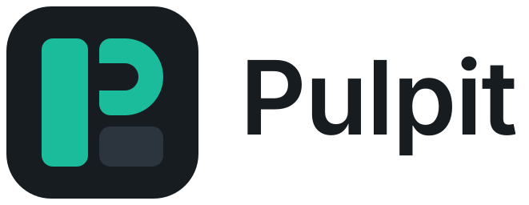
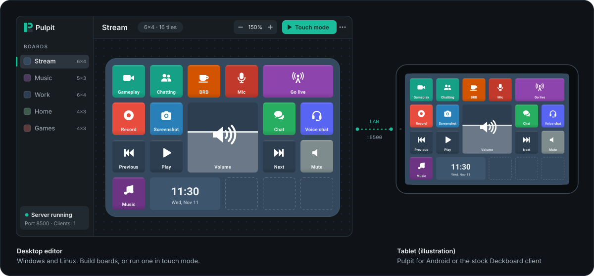
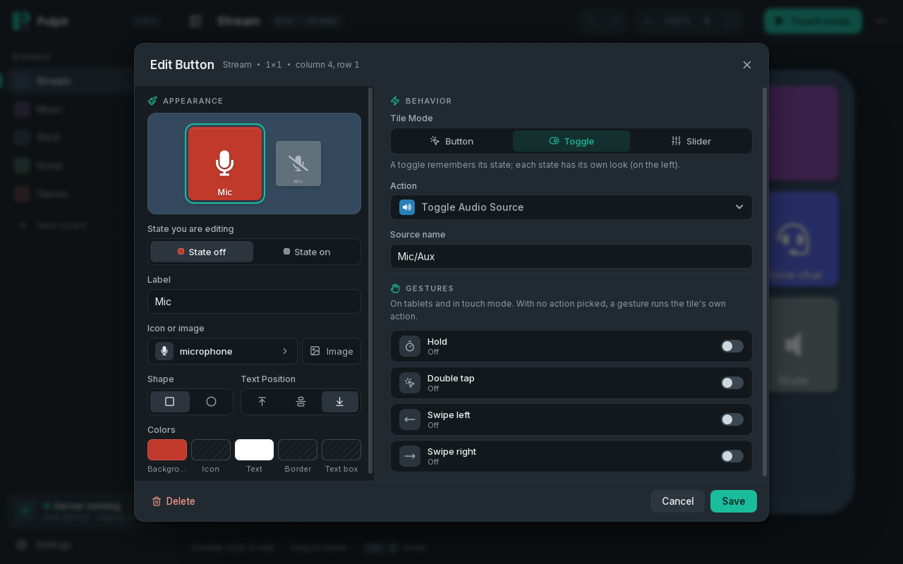
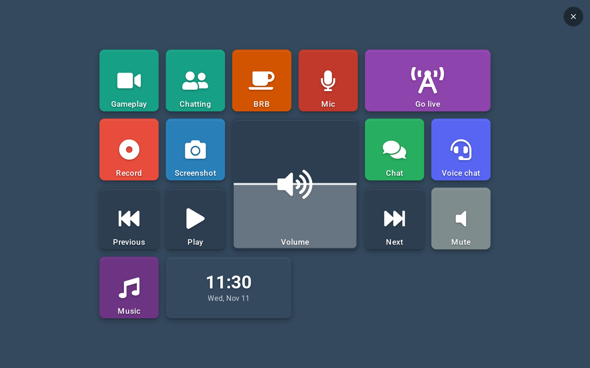
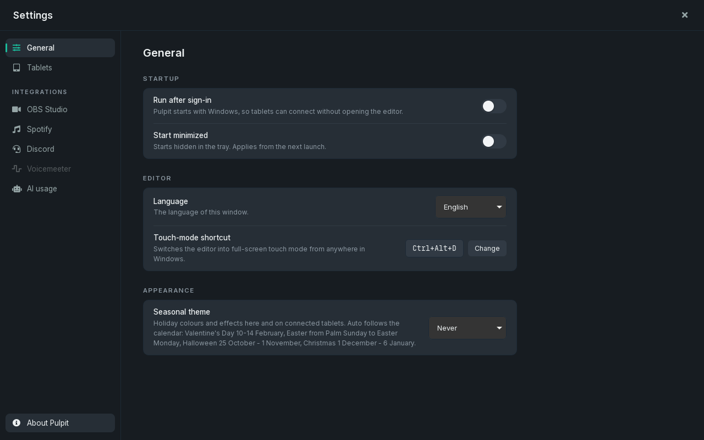
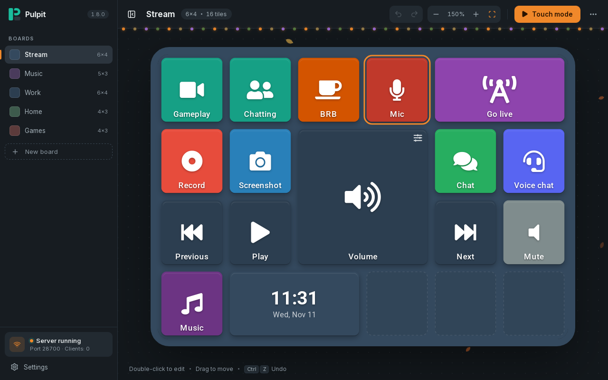
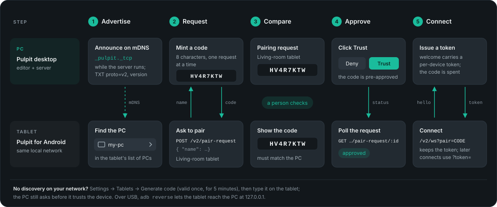
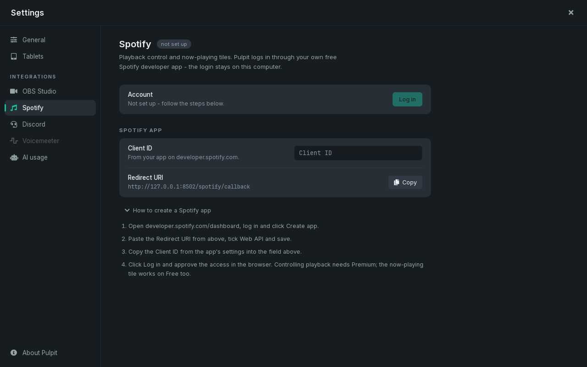

<h1>
  <picture>
    <source media="(prefers-color-scheme: dark)" srcset="docs/brand/pulpit-lockup-dark.svg">
    
  </picture>
</h1>

[](LICENSE)
[](https://github.com/TymekTM/Pulpit/releases/latest)
[](https://github.com/TymekTM/Pulpit/actions/workflows/ci.yml)




Turn a tablet into a button board for your PC. Pulpit is a desktop app for
Windows and Linux with a board editor and a full-screen touch mode, plus a
server on your local network that tablets connect to. Buttons run actions
on the PC, sliders drag, and toggle tiles flip on live state such as the
system volume, the playing track or the current OBS scene.

It started as a Rust rewrite of Deckboard 3.x and stays compatible with
that ecosystem: the stock Deckboard Android client works out of the box,
`.boardjson` boards import and export unchanged, and original Deckboard
extensions load in an embedded JavaScript runtime. Pulpit also has its own
Android client.

## What it looks like


| Tile editor: appearance on the left, behavior on the right | Touch mode: the board as a touch surface |
| --- | --- |
|  |  |
| **Settings: General** | **Seasonal theme: Halloween** |
|  |  |

These are screenshots of the desktop app running on Linux with a demo
board. The Android client is not shown here; the tablet in the picture at
the top is an illustration.

## Features

**Boards**

- Board editor: add, drag and resize tiles; multi-cell tiles; dual-state
  styling with a live preview of both states; undo and redo; zoom or fit
  to the window; empty cells shown as open slots.
- Tile modes: button, toggle (two looks, flipped by live state or by tap)
  and slider. Gestures (hold, double tap, swipe left and right) run on
  tablets and in touch mode.
- Touch mode: the board becomes a full-screen touch surface on the PC,
  opened from the editor or with a global shortcut (Ctrl+Alt+D by default,
  configurable).
- `.boardjson` import and export, format-compatible with Deckboard.
- English and Polish UI (Settings → General → Language). Status texts that
  the server pushes to tablets, such as the media "nothing playing" line,
  follow the same language.
- Seasonal themes for Christmas, Halloween, Easter and Valentine's Day:
  holiday colours and effects in the editor and on connected tablets, off,
  forced, or following the calendar (Settings → General → Seasonal theme).

**Actions and live state**

- Keyboard macros and key sequences, typed text, mouse control, open a URL,
  folder or file, run a program, screenshots, play an audio file, switch
  boards, multi-actions.
- System audio: volume slider, mute, media keys and default output device
  switching (WASAPI on Windows, `pactl` on Linux), with the live volume,
  mute and device pushed to every client.
- **System media**: a "now playing" tile with cover art, title, artist and
  a progress bar, plus play/pause, next, previous, stop and seek tiles for
  whatever player the system reports (browser, Tidal, VLC, foobar2000, not
  only Spotify). Windows uses the system media session, Linux uses MPRIS.
  On Windows and Linux a tile can target one player by name.
- **HTTP request tiles**: method, URL, headers and body, sent by the server
  when the tile is pressed (Home Assistant, webhooks, n8n or any REST API).
  Configurable timeout, an opt-in to ignore certificate errors, and
  `{{var:...}}` placeholders filled with current variable values. The
  status code, or a value picked from the JSON response by a pointer or
  dotted path, is stored in a variable that a display tile shows live.
  Logs record only the scheme and host of the URL, never the full address.
- **Tools**: clock, countdown timer, stopwatch and counter tiles. Their
  state lives on the server (`~/pulpitApp/tools.json`), so every tablet and
  the desktop touch mode show the same value. A finished timer can play a
  sound on the PC or switch the board, and the tile flashes on every
  surface.
- **System info**: native CPU and RAM load tiles.
- **AI usage**: plan-limit tiles with usage bars and reset countdowns for
  z.ai GLM, Claude, Codex and OpenRouter, plus any custom JSON endpoint set
  up in `aidev.json`. Settings → AI usage picks the rows and the look.
- Integrations, each set up from its own Settings page:
  [Spotify](#spotify), [OBS Studio](#obs-studio), [Discord](#discord)
  (Windows) and [Voicemeeter](#voicemeeter) (Windows).

**Tablets and pairing**

- Two protocols on one port (8500 by default): the legacy socket.io
  protocol the stock Deckboard Android client speaks, and Pulpit protocol
  v2 (plain WebSocket, typed schema, one-time pairing codes, per-device
  tokens, delta sync). See [`docs/protocol-v2.md`](docs/protocol-v2.md).
- Discovery pairing: the desktop announces itself over mDNS, the tablet
  lists it, the same code shows on both screens, and pairing completes only
  after you approve it on the PC. Manual codes and USB (`adb reverse`)
  work where multicast does not.
- Native Android client (Kotlin/Compose): offline board cache, a
  foreground service that keeps the connection, gestures, haptics.
- Settings → Tablets lists paired devices (revoke any of them), shows the
  address and QR code for the stock client, and lets you change the port.

**Maintenance**

- Self-updater (Windows): the desktop checks a `latest.json` feed,
  downloads the release over HTTPS, verifies its SHA-256 and replaces
  itself, restarting automatically (Settings → About Pulpit).
- Tablet updater: Settings → Tablets → Install over USB installs the
  latest release APK (also checked against its SHA-256) or an APK file you
  pick on every USB-connected tablet, with `adb install -r`, so data and
  pairing are kept. Tablets already on the feed's version are skipped.
- Tray icon, close to tray, run after sign-in, start minimized, single
  instance, daily-rotated logs.
- Extensions: original Deckboard `.asar` extensions run in an embedded
  JavaScript engine. The system-info and callurl extensions are replaced by
  native code; Spotify, OBS, Discord and Voicemeeter are native
  integrations.

## Install

### Windows

Download `pulpit-desktop-<version>.exe` from
[Releases](https://github.com/TymekTM/Pulpit/releases/latest). It is a
single binary with no installer, for Windows 10 and 11. The app checks for
newer releases on its own and can update itself in place.

### Linux

There is no Linux release binary yet; build the desktop app or the
headless server from source (see [Build from source](#build-from-source)).
Most features work. Instead of native libraries, Pulpit calls standard
desktop tools, and a feature whose tool is missing reports itself as
unsupported:

| Feature | Tool |
| --- | --- |
| Volume / mute / output device | `pactl` (PulseAudio or PipeWire-pulse) |
| Now-playing media + control | `busctl --user` (systemd) speaking MPRIS |
| Clipboard | `wl-copy`/`wl-paste` (Wayland) or `xclip` (X11) |
| Screenshot | `grim` (Wayland) or `import` (ImageMagick, X11) |
| Play Audio tiles | first of `pw-play`, `paplay`, `aplay` |
| System-info tiles | none (reads `/proc`) |

All tools are called with `LC_ALL=C`, so their output is never translated
before Pulpit parses it. Not available on Linux: Voicemeeter (greyed out in
the editor and in Settings), the Discord integration, the self-updater, and
keyboard input into native Wayland windows (the keyboard backend reaches
X11 and XWayland windows only).

### Android

Install `pulpit-<version>.apk` from the same release on the tablet, or use
the stock Deckboard Android app.

### Upgrading from Deckboard

On first launch Pulpit copies an existing `~/deckboard` data directory
(database, settings, paired devices, extensions, assets) into
`~/pulpitApp`, so moving over from the original app needs no manual steps.
The original app keeps its files and keeps working.

### Connecting a tablet

- **Stock Deckboard app**: scan the QR code in Settings → Tablets. No
  pairing step.
- **Pulpit for Android**: pick the PC from the list on the tablet, check
  that the code on the tablet matches the one in the dialog on the PC, and
  click Trust. If the tablet does not see the PC, click Generate code in
  Settings → Tablets (the code works once, for 5 minutes) and type it on
  the tablet together with the address.



## Build from source

Prerequisites: a stable Rust toolchain (MSVC on Windows), Node.js with npm,
and for the Android client JDK 17 and the Android SDK. On Debian or Ubuntu,
the desktop app also needs the WebKitGTK stack:

```sh
sudo apt install libwebkit2gtk-4.1-dev libgtk-3-dev libsoup-3.0-dev \
  libayatana-appindicator3-dev librsvg2-dev libxdo-dev
```

```sh
# desktop app, dev mode with live reload
cd apps/desktop
npm install
npm run tauri dev

# standalone release binary: target/release/pulpit-desktop(.exe)
npx tauri build --no-bundle

# headless server only (no window): target/release/pulpit-server(.exe)
cargo build --release -p pulpit-server
```

Build a distributable desktop binary with `npx tauri build`, not with a
plain `cargo build --release -p pulpit-desktop`: the latter compiles but
points the window at the Vite dev server (`http://localhost:5173`), so it
opens on a connection error unless that server is running.

Tests and lints run from the repo root:

```sh
cargo test --workspace        # live device tests are #[ignore]d; run them with -- --ignored
cargo clippy --workspace --all-targets
cd apps/desktop && npx vite build

# Android client unit tests
cd apps/mobile && gradle :app:testDebugUnitTest
```

## Data and configuration

Everything lives in `~/pulpitApp` (`pulpit_db::data_dir`): `database.db`,
`settings.json`, `editor.json` (editor settings such as the port, the
shortcut, the language and the seasonal theme), `aidev.json`,
`devices.json`, `spotify.json`, `obs.json`, `tools.json`, `extensions/`,
`assets/`, `logs/`. Environment overrides:

| Variable | Default | Purpose |
| --- | --- | --- |
| `PULPIT_PORT` | `8500` | Server port (legacy + v2 share it); overrides the port set in Settings |
| `PULPIT_DB` | `~/pulpitApp/database.db` | Desktop only: database location (profiling, hermetic runs). The headless server takes the path as its first argument |
| `PULPIT_EXT_DIR` | `~/pulpitApp/extensions` | Extension directory |
| `PULPIT_AIDEV_CONFIG` | `~/pulpitApp/aidev.json` | AI usage config |
| `PULPIT_SPOTIFY_CONFIG` | `~/pulpitApp/spotify.json` | Spotify client id and tokens |
| `PULPIT_OBS_CONFIG` | `~/pulpitApp/obs.json` | OBS connection settings (host, port, password) |
| `PULPIT_DEVICES` | next to the database | Headless server only: paired-devices file |
| `PULPIT_ASSETS` | next to the database | Headless server only: assets directory |
| `PULPIT_NO_SINGLE_INSTANCE` | unset | Any value: allow side-by-side desktop instances |
| `PULPIT_NO_DISCOVERY` | unset | Any value: skip the mDNS announcement |

## Spotify

Pulpit talks to the Spotify Web API directly (native `crates/spotify`, no
extension). Login and configuration live only in the desktop app; tablets
just render and press the tiles.

**Setup (once)**, in Settings → Spotify:

1. Create an app at <https://developer.spotify.com/dashboard>.
2. Add the redirect URI `http://127.0.0.1:8502/spotify/callback` exactly as
   written (the Settings page shows it with a Copy button). Port 8502 is
   fixed and independent of `PULPIT_PORT`, because Spotify matches the URI
   exactly.
3. Paste the app's Client ID and click Log in. The browser opens, and after
   you approve, Pulpit catches the redirect on 127.0.0.1:8502 (5-minute
   window). If something else holds 8502, the login fails with a clear
   error instead of picking another port.



Tokens are stored in `~/pulpitApp/spotify.json` (override the path with
`PULPIT_SPOTIFY_CONFIG`). Refresh-token rotation is handled and tokens are
never logged. Logging out deletes the tokens and keeps the Client ID. The
headless server reads the same file; without it Spotify is simply off.

**Tiles** (catalog group "Spotify")

| Kind | Does |
| --- | --- |
| `spotify-playback` | play/pause, next, previous, volume ±10 %, mute/restore |
| `spotify-shuffle` | toggle shuffle (lit while on) |
| `spotify-repeat` | cycle off → context → track (lit unless off) |
| `spotify-like` | save/unsave the current track (lit while saved) |
| `spotify-add` | add the current track to a chosen playlist |
| `spotify-tracks` | start a playlist, album, track or artist |
| `spotify-device` | move playback to a device (matched by name) |
| `spotify-volume` | slider, follows the live volume |
| `spotify-seek` | slider, follows track progress |
| `spotify-now-playing` | status tile: title, artist, album, cover, progress |

Playback control requires Spotify Premium (the Web API refuses it for Free
accounts; the status tiles still work). Spotify must be open on some device
first: Pulpit controls an existing player, it is not one. State is polled
about every 3 s while playing and every 20 s while paused. Pulpit sends no
requests at all while no tablet is connected and the editor window is
hidden. Tiles extrapolate track progress between polls.

## OBS Studio

Pulpit talks to OBS Studio directly over obs-websocket v5 (native
`crates/obs`, no extension; OBS 28+ ships the plugin built in, default
`ws://127.0.0.1:4455`). Setup: in Settings → OBS Studio, turn on Connect
to OBS, fill in the address and the password from OBS's Tools → WebSocket
Server Settings, click Test, then Save. The config lives in
`~/pulpitApp/obs.json` (override the path with `PULPIT_OBS_CONFIG`),
written atomically; the password is never logged. Changes reconnect
without an app restart, and a disabled config opens no connection at all.
The headless server reads the same file.

**Tiles** (catalog group "OBS Studio")

| Kind | Does |
| --- | --- |
| `obs-scene` | switch program scene (lit while it is the live scene) |
| `obs-source` | toggle a scene item in the current program scene (lit while visible) |
| `obs-device-audio` | toggle input mute (lit while muted) |
| `obs-filter` | toggle a source filter (lit while enabled; the source is guessed from the filter when omitted) |
| `obs-studio-mode` | toggle studio mode (lit while on) |
| `obs-record` | toggle recording (lit while recording) |
| `obs-stream` | toggle streaming (lit while live) |
| `obs-replay-save` | save the replay buffer |
| `obs-audio-slider` | input volume fader, follows the live volume |

Toggle tiles light up from the real OBS state on every surface (events are
pushed through the same live-state lane as Spotify and system info), and
the tile dialog offers scene, source, input and filter pickers fed from the
connection while it is up. The Streamlabs (SLOBS), XSplit and Twitch kinds
from the original app are not implemented: they stay listed greyed-out in
the picker, load from stock boards, and a press warns once per kind
instead of once per press. An installed extension that provides one of
those kinds still wins.

## Discord

Windows only. Pulpit talks to the local Discord client over its RPC named
pipe (native `crates/discord`, replacing the `discord-deckboard`
extension, which needs Node sockets). Voice actions work on the desktop
and on tablets alike.

**Setup (once)**, in Settings → Discord:

1. Create an app at <https://discord.com/developers/applications>.
2. In OAuth2 add the redirect `https://discord.com` exactly as written
   (never actually opened: the authorization runs over the local pipe).
3. Paste the Client ID and Client Secret and save, then click Connect and
   approve Pulpit in the Discord window.

Credentials live in `~/pulpitApp/settings.json` under the contractual
`discord-deckboard` package (the field names the original extension used),
with the tokens next to them; Disconnect clears the tokens and keeps the
ID and secret. Saving reloads the running app, no restart needed. The
headless server re-reads the file (mtime check) before its next Discord
action, so edits made in the desktop reach it without a restart too.
Secrets and tokens are never logged.

**Per-member volume** (music bots): *Discord: User Volume* (slider) and
*Discord: Mute User* (toggle) control the local per-user volume override
the Discord client applies to one voice-channel member, the same slider
Discord's right-click menu shows. It works on every bot regardless of
premium tiers, and only you hear the change. Set the member's `user_id`
snowflake in the tile's field; the tile tracks the selected voice channel
and keeps name and volume live both ways (drag in Discord, the tile
follows; drag the tile, Discord follows). The slider spans Discord's
0–200 %, with a double tap snapping back to 100 %. Volumes set over RPC
revert when Pulpit exits, and only one app at a time may hold Discord's
voice-write lock (a running Stream Deck Discord plugin will conflict).

## Voicemeeter

Windows only; on Linux the Voicemeeter page and tiles are greyed out.
Voicemeeter tiles drive the `VoicemeeterRemote64.dll` remote API directly
(native `crates/vm`). The DLL is found automatically in the standard
install locations; a nonstandard install can point at the file in
Settings → Voicemeeter → Advanced (stored in `settings.json` under
`voicemeeter.dllPath`, consulted first). The page shows the connection
status and can reconnect or start Voicemeeter.

Strip and bus pickers in the tile editor show live labels (`0 (Mic)`,
`0 (A1)`) read from the running Voicemeeter; without a connection they fall
back to the static indices. Stored values stay the numeric index, so boards
keep working when Voicemeeter is absent.

## Architecture


One Cargo workspace, thin crates with a single job each:

| Crate | Role |
| --- | --- |
| `crates/db` | SQLite access, schema, data dir + legacy migration |
| `crates/actions` | Command catalog and dispatch behind a testable `Input` seam |
| `crates/os` | Platform layer: Windows (WASAPI, media session, capture, clipboard) and Linux (`pactl`, MPRIS, desktop tools) |
| `crates/host` | Host runtime shared by the desktop and the headless server: producer pumps, speaker watcher |
| `crates/sysinfo` | Native system-info source (CPU and RAM load) |
| `crates/aidev` | AI usage source: plan limits, agent status, local token sums |
| `crates/tools` | Clock, timer, stopwatch and counter tiles, state kept on the server |
| `crates/season` | Seasonal themes: picks the active season and pushes it to every client |
| `crates/i18n` | Locale for the display texts in status payloads |
| `crates/legacy` | Engine.IO v3 + socket.io v2 server for the stock Android client |
| `crates/proto` | Protocol v2 typed schema + TS bindings + golden JSON fixtures |
| `crates/v2` | v2 transport: sessions, pairing, devices, discovery, assets, state engine |
| `crates/backend` | SQLite backend shared by the editor and the headless server |
| `crates/ext` | Extension host: original Deckboard extensions on an embedded JS engine |
| `crates/spotify` | Native Spotify Web API integration |
| `crates/obs` | Native OBS Studio integration (obs-websocket v5) |
| `crates/discord` | Native Discord local-RPC integration (Windows) |
| `crates/vm` | Native Voicemeeter integration (Windows) |
| `apps/desktop` | Tauri 2 + Vue 3 editor and touch surface |
| `apps/server` | Headless server binary (legacy + v2) |
| `apps/mobile` | Kotlin/Compose Android client |

Further reading:

- [`docs/protocol-v2.md`](docs/protocol-v2.md): wire protocol, pairing, state sync
- [`docs/decisions.md`](docs/decisions.md): architecture decision records
- [`DESIGN.md`](DESIGN.md): the desktop design system
- [`ROADMAP.md`](ROADMAP.md): milestones and status

## Compatibility with Deckboard

Pulpit is an independent project, not affiliated with Deckboard. It
interoperates with the Deckboard ecosystem on purpose: the stock Android
client (Free and Pro) connects to the legacy protocol, boards round-trip
through `.boardjson`, extensions load unmodified, and first launch migrates
your data instead of holding it hostage. Naming inside `settings.json`
(such as the `discord-deckboard` package) is preserved for compatibility.

## License

[MIT](LICENSE) - Tymoteusz "TymekTM" Bielski
